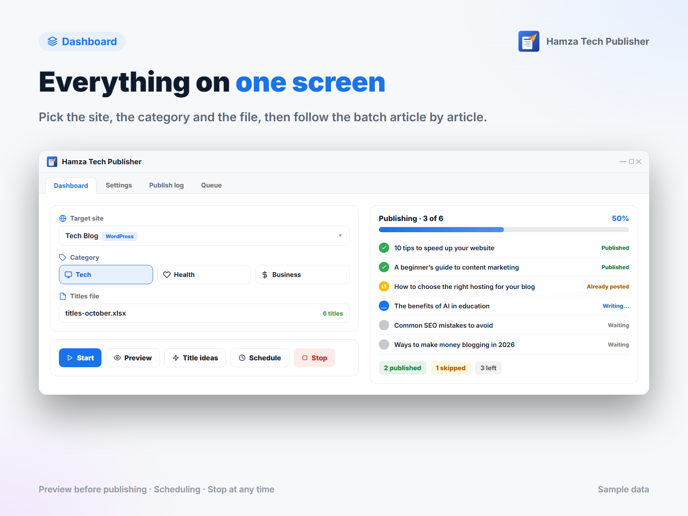

# Hamza Publisher

[العربية](README.md) · **English**

A desktop app that auto-publishes articles to **Blogger** blogs and **WordPress** sites from a list of titles in an Excel file. For each title it writes the article with AI, fetches a header image, adds SEO metadata and internal links, publishes, then shares the link to Telegram or Facebook.

It talks to the providers directly with your own API keys: no monthly subscription, no middleman server, and all your data stays on your machine.



## Features

- **Two platforms in one list:** Blogger blogs (Google OAuth) and WordPress sites (Application Passwords).
- **Three content providers:** OpenAI, Gemini and Claude; the model name is a setting.
- **Header images:** from Unsplash or generated with OpenAI image models, without reusing the same image on one blog.
- **Quality check before publishing:** an empty, truncated or Markdown reply is regenerated once, then logged as a retryable failure.
- **SEO:** meta description, tags and image alt text, plus a "Read also" section linking to related earlier articles on the same blog.
- **Duplicate guard:** a title already published to the same blog is skipped.
- **A queue that survives closing the app:** an interrupted batch resumes where it stopped without republishing anything.
- **Per-blog profiles:** a different language, provider, post status and default category per target.
- **Draft mode:** publish as drafts and review before readers see them.
- **Title generator**, article preview, and scheduling a batch for later.
- **Automatic sharing** to a Telegram channel or a Facebook Page after publishing.
- **Arabic (RTL) and English UI**, light and dark themes.
- **Secrets encrypted at rest** with Windows DPAPI.

## Install

Download the installer from the [Releases](https://github.com/MohamedSalah-13/publisher/releases) page. It bundles its own Java runtime and installs for the current user without administrator rights.

> The app targets **Windows 10/11**. Running from source elsewhere is possible, but secret encryption relies on Windows; on other systems keys are stored as plain text.

## Setup

On first launch a **setup wizard** walks you through three steps: a content provider key, an image key, and where to publish. Each key is checked with its provider before it is saved, and every step can be skipped. Publishing to WordPress needs no Google account at all.

Everything in the wizard can be changed later in the **Settings** screen, and the wizard can be reopened from the sign-in screen.

| What you need | When | Where to get it |
|---|---|---|
| A key for at least one content provider | Always | [OpenAI](https://platform.openai.com/api-keys), [Gemini](https://aistudio.google.com/app/apikey) or [Claude](https://console.anthropic.com/settings/keys) |
| `credentials.json` | Publishing to Blogger | Google Cloud Console (steps below) |
| Application Password | Publishing to WordPress | WordPress admin → Users → Profile |
| Unsplash key | Images (required for Blogger images) | [Unsplash Developers](https://unsplash.com/oauth/applications) |
| Telegram bot token / Facebook Page token | Sharing, optional | See the [Arabic README](README.md) |

### Blogger: `credentials.json`

1. Open [Google Cloud Console](https://console.cloud.google.com/) and create a project.
2. Under **APIs & Services → Library**, enable **Blogger API v3**.
3. Configure the **OAuth consent screen** (External) and add your account under **Test users**.
4. Under **Credentials → Create Credentials → OAuth client ID**, choose **Desktop app**.
5. Download the JSON, name it `credentials.json`, and put it in `%LOCALAPPDATA%\HamzaPublisher` (or the project root when running from source).

While the Google app is in Testing mode, the sign-in expires every 7 days and you have to sign in again.

### WordPress

In the **WordPress sites** screen, add the site URL, username and an Application Password. The URL must be `https`; the app refuses to send credentials over an unencrypted connection.

## Usage

1. **Prepare titles:** an `.xlsx` file with titles in the first column; the first row is a header and is skipped. Or use **Generate titles** to have the AI suggest them.
2. **Pick the target** (a Blogger blog or a WordPress site) and a category. The category is required for Blogger and optional for WordPress.
3. **Preview** an article if you like, then press **Start**.
4. **Check the results** in the publish log: each article's link, and the reason for any failure with a retry button.

> **Tip:** search engines penalise mass-generated content published without review. Use draft mode and review articles before they go live.

## Run from source

Requires **JDK 25** or later (the build fails on anything older). Maven is included through `mvnw`.

```bash
git clone https://github.com/MohamedSalah-13/publisher.git
cd publisher
./mvnw javafx:run
```

| Command | Purpose |
|---|---|
| `./mvnw test` | Run the tests |
| `./mvnw clean package` | Build the runnable jar in `target/` |
| `.\packaging\build-installer.ps1` | Build the Windows installer in `target\installer\` |

Building the installer needs [WiX Toolset 3](https://github.com/wixtoolset/wix3/releases), or pass `-Type app-image` for a portable build without WiX. A `credentials.json` in the project root is bundled into the installer; pass `-NoCredentials` to leave it out.

## Where data lives

Settings, logs, the queue and the Google session are stored in `%LOCALAPPDATA%\HamzaPublisher`. API keys and WordPress passwords are DPAPI-encrypted and tied to the current Windows account, so a file copied to another machine makes the app ask for them again.

## Contributing

Architecture and conventions are documented in [CLAUDE.md](CLAUDE.md). Adding a content provider, an image provider or a publish platform is one class plus one line in `ProviderRegistry.registerBuiltIns()`. Open an issue or send a pull request.

## License

[MIT](LICENSE)
