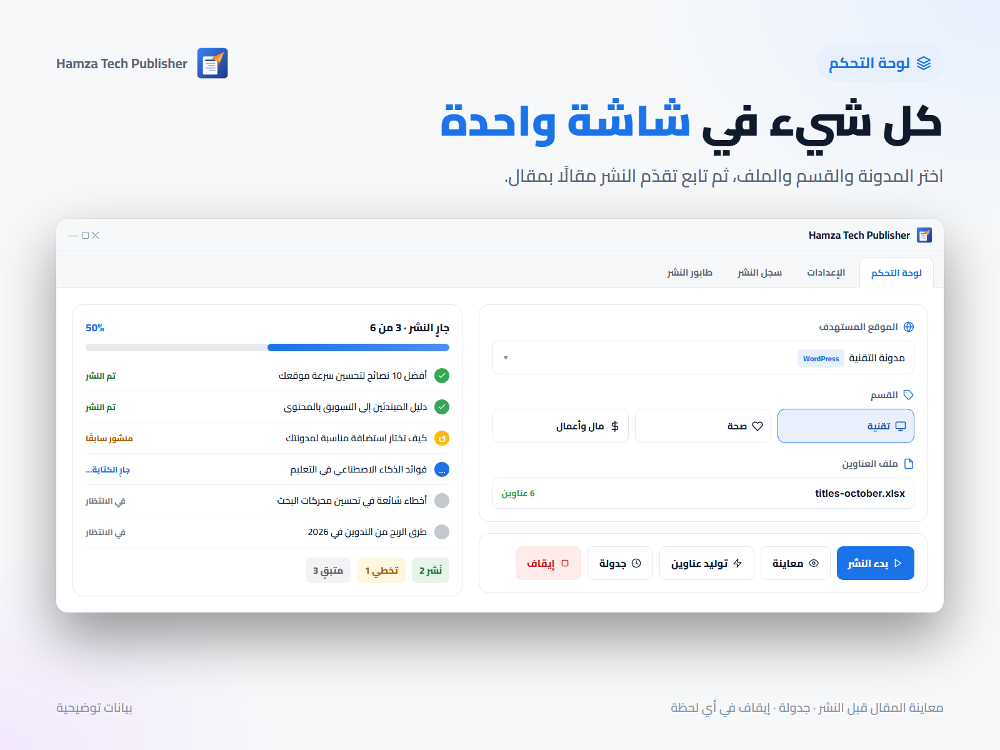

# Hamza Publisher

**العربية** · [English](README.en.md)

برنامج سطح مكتب ينشر المقالات تلقائيًا على مدونات **Blogger** ومواقع **WordPress** انطلاقًا من قائمة عناوين في ملف Excel. لكل عنوان يكتب المقال بالذكاء الاصطناعي، يجلب صورة رئيسية، يضيف بيانات SEO وروابط داخلية، ينشر، ثم يشارك الرابط على تيليجرام أو فيسبوك.

يعمل بمفاتيحك أنت مباشرة مع المزوّدين: لا اشتراك شهري، ولا خادم وسيط، وكل بياناتك تبقى على جهازك.



## المميزات

- **منصتان في قائمة واحدة:** مدونات Blogger (عبر Google OAuth) ومواقع WordPress (عبر Application Password).
- **ثلاثة مزوّدين للمحتوى:** OpenAI و Gemini و Claude، واسم النموذج إعداد تغيّره متى شئت.
- **صور رئيسية:** من Unsplash، أو مولَّدة بنماذج الصور من OpenAI، مع تجنّب تكرار الصورة نفسها على المدونة الواحدة.
- **فحص جودة قبل النشر:** المقال الفارغ أو المبتور أو المكتوب بـ Markdown يُعاد توليده مرة، ثم يُسجَّل فشلًا قابلًا لإعادة المحاولة.
- **SEO:** وصف ميتا ووسوم ونص بديل للصورة، وقسم "اقرأ أيضًا" بروابط لمقالات سابقة ذات صلة على المدونة نفسها.
- **منع التكرار:** العنوان المنشور سابقًا على المدونة نفسها يُتخطّى.
- **طابور يستكمل بعد الإغلاق:** إذا أُغلق البرنامج أو انقطع أثناء دفعة، يكمل من حيث توقف دون إعادة نشر ما نُشر.
- **إعدادات خاصة لكل مدونة:** لغة ومزوّد وحالة نشر وقسم افتراضي مختلفة لكل وجهة.
- **وضع المسودة:** انشر كمسودات وراجعها قبل ظهورها للقراء.
- **مولّد عناوين** ومعاينة للمقال قبل النشر، وجدولة لبدء الدفعة في وقت لاحق.
- **مشاركة تلقائية** في قناة تيليجرام أو صفحة فيسبوك بعد النشر.
- **واجهة عربية (RTL) وإنجليزية**، بوضعين فاتح وداكن.
- **المفاتيح مشفّرة على القرص** بـ Windows DPAPI.

## التثبيت

حمّل ملف التثبيت من صفحة [Releases](https://github.com/MohamedSalah-13/publisher/releases). يحمل نسخة Java خاصة به، ويُثبَّت للمستخدم الحالي دون صلاحيات مدير.

> البرنامج يعمل على **Windows 10/11**. التشغيل من المصدر على أنظمة أخرى ممكن، لكن تشفير المفاتيح يعتمد على Windows، وعلى غيره تُحفظ نصًا عاديًا.

## الإعداد

عند أول تشغيل يفتح **معالج إعداد** يقودك في ثلاث خطوات: مفتاح مزوّد المحتوى، مفتاح الصور، ووجهة النشر. كل مفتاح يُفحص عند المزوّد قبل حفظه، وكل خطوة يمكن تخطّيها. النشر على ووردبريس لا يحتاج حساب Google إطلاقًا.

كل ما في المعالج يمكن تغييره لاحقًا من شاشة **الإعدادات**، ويمكن فتحه من جديد من شاشة تسجيل الدخول.

| ما تحتاجه | متى | من أين |
|---|---|---|
| مفتاح مزوّد محتوى واحد على الأقل | دائمًا | [OpenAI](https://platform.openai.com/api-keys) أو [Gemini](https://aistudio.google.com/app/apikey) أو [Claude](https://console.anthropic.com/settings/keys) |
| ملف `credentials.json` | للنشر على Blogger | Google Cloud Console (الخطوات أدناه) |
| Application Password | للنشر على WordPress | لوحة ووردبريس ← المستخدمون ← الملف الشخصي |
| مفتاح Unsplash | للصور (ومطلوب لصور Blogger) | [Unsplash Developers](https://unsplash.com/oauth/applications) |
| توكن بوت تيليجرام / توكن صفحة فيسبوك | للمشاركة، اختياري | الخطوات أدناه |

### Blogger: ملف `credentials.json`

1. افتح [Google Cloud Console](https://console.cloud.google.com/) وأنشئ مشروعًا.
2. من **APIs & Services ← Library** فعّل **Blogger API v3**.
3. من **OAuth consent screen** اختر External واملأ البيانات، وأضف حسابك في **Test users**.
4. من **Credentials ← Create Credentials ← OAuth client ID** اختر النوع **Desktop app**.
5. نزّل ملف JSON وسمّه `credentials.json`، وضعه في `%LOCALAPPDATA%\HamzaPublisher` (أو في جذر المشروع عند التشغيل من المصدر).

ما دام التطبيق في وضع Testing لدى Google، تنتهي صلاحية تسجيل الدخول كل 7 أيام ويلزم تسجيل الدخول من جديد. شرح أكثر تفصيلًا في [TESTING_GUIDE.md](TESTING_GUIDE.md).

### WordPress

من شاشة **مواقع ووردبريس** أضف رابط الموقع واسم المستخدم و Application Password (تُنشأ من لوحة ووردبريس ← المستخدمون ← الملف الشخصي). الرابط يجب أن يكون `https`؛ البرنامج يرفض إرسال بيانات الدخول عبر اتصال غير مشفّر.

### المشاركة على تيليجرام وفيسبوك (اختياري)

التوكنات تُكتب في **الإعدادات ← المشاركة على الشبكات الاجتماعية**، والوجهة (القناة أو الصفحة) تُضبط لكل مدونة من زر "إعدادات نشر خاصة بهذه الوجهة". حقل فارغ يعني بلا مشاركة. المسودات لا تُشارَك، وفشل المشاركة لا يُفشل المقال ولا يعيد نشره؛ يظهر السبب في تفاصيل السجل.

**تيليجرام**

1. افتح [@BotFather](https://t.me/BotFather) وأرسل `/newbot`، ثم الصق التوكن في الإعدادات.
2. أضف البوت مشرفًا في قناتك بصلاحية **Post Messages**.
3. اكتب القناة في إعدادات المدونة: `@channelname` للقناة العامة، أو المعرّف الرقمي الذي يبدأ بـ `-100` للخاصة.

**فيسبوك (صفحات فقط)**

Meta لا تسمح للتطبيقات بالنشر على الحسابات الشخصية ولا في المجموعات؛ المدعوم هو الصفحات التي تديرها.

1. أنشئ تطبيقًا من [developers.facebook.com/apps](https://developers.facebook.com/apps) (نوع Business).
2. من [Graph API Explorer](https://developers.facebook.com/tools/explorer) اطلب User Access Token بالصلاحيات `pages_manage_posts` و `pages_read_engagement` و `pages_show_list`.
3. حوّله إلى توكن طويل الأمد:
   ```
   GET https://graph.facebook.com/v24.0/oauth/access_token?grant_type=fb_exchange_token&client_id=APP_ID&client_secret=APP_SECRET&fb_exchange_token=SHORT_TOKEN
   ```
4. اطلب `GET /me/accounts` بالتوكن الطويل. لكل صفحة `id` و `access_token`؛ توكن الصفحة لا تنتهي صلاحيته. الصقه في الإعدادات، والصق `id` الصفحة في إعدادات المدونة.

## الاستخدام

1. **جهّز العناوين:** ملف `.xlsx` فيه العناوين في العمود الأول، والصف الأول عنوان للعمود (يُتخطّى). أو استخدم زر **توليد عناوين** ليقترحها الذكاء الاصطناعي.

   | العنوان |
   |---|
   | أفضل لغات البرمجة للمبتدئين |
   | كيف تتعلم البرمجة من الصفر |

2. **اختر الوجهة** من القائمة (مدونة Blogger أو موقع WordPress) ثم القسم. القسم إلزامي في Blogger واختياري في WordPress.
3. **عاين** مقالًا قبل النشر إن أردت، ثم اضغط **ابدأ**.
4. **تابع النتيجة** في شاشة السجلات: رابط كل مقال، وسبب أي فشل مع زر لإعادة المحاولة.

> **نصيحة:** محركات البحث تعاقب المحتوى المولَّد بكميات كبيرة دون مراجعة. استخدم وضع المسودة وراجع المقالات قبل نشرها.

## التشغيل من المصدر

يتطلب **JDK 25** أو أحدث (البناء يفشل على ما هو أقدم). Maven مضمَّن عبر `mvnw`.

```bash
git clone https://github.com/MohamedSalah-13/publisher.git
cd publisher
./mvnw javafx:run
```

| الأمر | الغرض |
|---|---|
| `./mvnw test` | تشغيل الاختبارات |
| `./mvnw clean package` | بناء ملف jar قابل للتشغيل في `target/` |
| `.\packaging\build-installer.ps1` | بناء مثبّت Windows في `target\installer\` |

بناء المثبّت يحتاج [WiX Toolset 3](https://github.com/wixtoolset/wix3/releases)، أو استخدم `-Type app-image` لنسخة محمولة بلا WiX. إن وُجد `credentials.json` في جذر المشروع يُضمَّن في المثبّت؛ استخدم `-NoCredentials` لاستبعاده.

## أين تُحفظ البيانات

الإعدادات والسجلات والطابور وجلسة Google تُحفظ في `%LOCALAPPDATA%\HamzaPublisher`. مفاتيح API وكلمات مرور ووردبريس مشفّرة بـ DPAPI ومرتبطة بحساب Windows الحالي، فإذا نُقل الملف إلى جهاز آخر يطلب البرنامج إدخالها من جديد.

## حل المشاكل الشائعة

- **فشل تسجيل الدخول لـ Google:** تأكد من مكان `credentials.json` ومن تفعيل Blogger API ومن أن حسابك ضمن Test users. إن استمر، احذف مجلد `tokens` من مجلد البيانات وسجّل الدخول من جديد.
- **مقالات بلا صور على Blogger:** يلزم مفتاح Unsplash؛ Blogger لا يستضيف الصور المولَّدة. حد Unsplash المجاني 50 طلبًا في الساعة.
- **فشل توليد المحتوى:** راجع المفتاح والرصيد لدى المزوّد. سبب الفشل مكتوب في شاشة السجلات.

## المساهمة

البنية والاصطلاحات موثّقة في [CLAUDE.md](CLAUDE.md). إضافة مزوّد محتوى أو صور أو منصة نشر جديدة تعني كلاسًا واحدًا وسطرًا في `ProviderRegistry.registerBuiltIns()`. افتح Issue أو أرسل Pull Request.

## الترخيص

[MIT](LICENSE)
